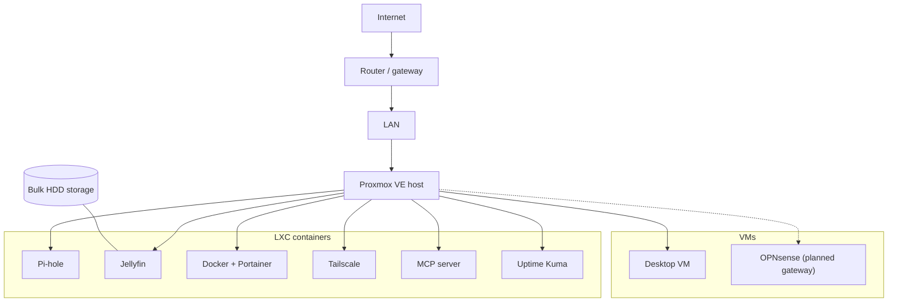

# Showcase

Technology projects built and run outside of work. Each topic has its own folder with an overview page and one page per technology.

## Topics

| Topic | Description |
|---|---|
| [Homelab](homelab/) | A single Proxmox server running self-hosted DNS, media, container, remote-access, monitoring and automation services |

## Technologies

| Technology | Category | Description |
|---|---|---|
| [Proxmox VE](homelab/proxmox.md) | Virtualization | Hypervisor hosting all containers and VMs, with scheduled updates and backups |
| [Pi-hole](homelab/pihole.md) | DNS / DHCP | Network-wide DNS filtering; also the only DHCP server on the network |
| [Jellyfin](homelab/jellyfin.md) | Media | Media server with the app on SSD and the library on bulk HDD storage |
| [Docker + Portainer](homelab/docker.md) | Containers | Container host for self-hosted apps, managed through the Portainer web UI |
| [Tailscale](homelab/tailscale.md) | Remote access | Subnet router that makes the LAN reachable remotely with no open ports |
| [Uptime Kuma](homelab/uptime-kuma.md) | Monitoring | HTTP, TCP and ping checks for every service in the lab |
| [Proxmox MCP server](homelab/proxmox-mcp.md) | Automation | Custom MCP server that lets an AI assistant inspect and manage the host |
| [OPNsense](homelab/opnsense.md) | Firewall / routing | Firewall VM with NIC passthrough; installed and staged, cutover planned |

## Homelab topology

